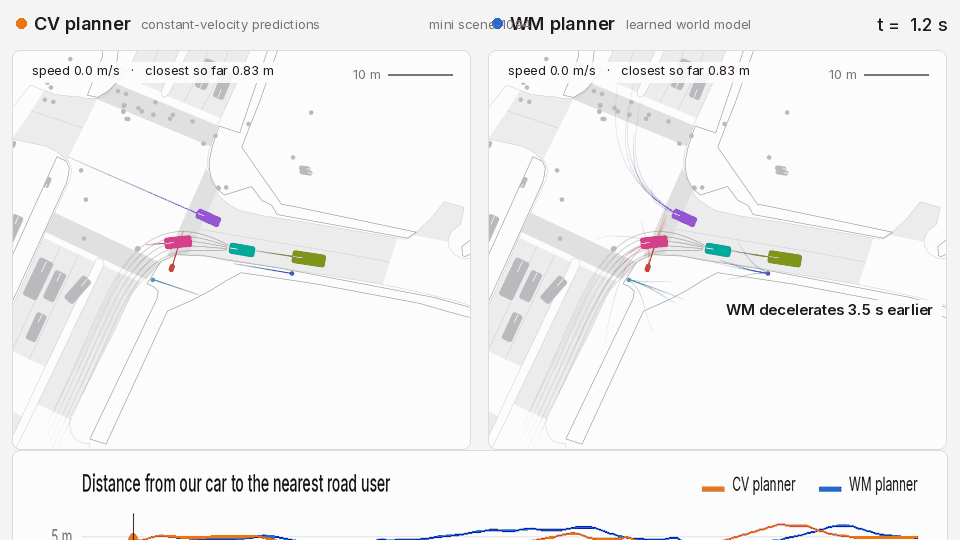

# obj-wm

Predicts how nearby road users react to our car's planned path, and uses those predictions to plan safer routes on nuScenes.



*mini scene-1094 (development). Rider enters from the left. CV crashed into the rider. WM keeps 0.83 m; it decelerates 3.5 s earlier.*

## How it works

- **World model:** [scene transformer](docs/architecture.png) predicting road-user futures conditioned on our candidate plan; trained with 20% plan dropout so it also works without one.
- **Planner:** sampling-based MPC: 35 candidate plans scored against predicted futures for risk, progress, comfort and lane offset; re-planned every 0.5 s.
- **Simulator:** nuScenes scenes in MetaDrive/ScenarioNet; other road users either *replay the log* (follow their recorded path, ignoring our car) or are *reactive* i.e. they adjust speed with [IDM](https://en.wikipedia.org/wiki/Intelligent_driver_model) when our car gets in the way.
- **Evaluation:** closed-loop test on 146 held-out nuScenes scenes with reactive road users.

## Results: closed loop on 146 test scenes

| Planner | Crashes | Within 1 m of others | Progress |
|---|---|---|---|
| CV | 1 | 8.3% | 0.917 |
| **WM** | **0** | **3.6%** | **0.917** |

Reactive IDM agents; 146 held-out test scenes. The 4.7 pp difference in near-miss rate is significant (97.5% CI [−8.0, −2.0], p = 1e-4); crashes are too rare to compare statistically.

[docs/EXPERIMENTS.md](docs/EXPERIMENTS.md) · [results/](results/)

## Quickstart

Download first (free [nuScenes account](https://nuscenes.org/nuscenes#download), non-commercial): the *mini* split (`v1.0-mini.tgz`, ~500 MB) and *map expansion v1.3* (~200 MB).

```bash
mkdir -p data/nuscenes_mini && tar xf v1.0-mini.tgz -C data/nuscenes_mini/
mkdir -p data/maps && unzip nuScenes-map-expansion-v1.3.zip -d data/maps/
ln -s ../maps data/nuscenes_mini/maps
```

```bash
make setup       # create Python environments (~5 min)
make data        # process nuScenes mini into training data
make train-mini  # train the world model (30 epochs, ~30 min on a GPU)
make demo        # run one scene closed-loop, write outputs/demo/scene1094_wm_vs_cv.gif
```

The mini-only model is weak (val minADE₆ ≈ 3.5 m vs 1.24 m on full data). The quickstart shows the pipeline works, not the numbers above. Full reproduction: [docs/EXPERIMENTS.md](docs/EXPERIMENTS.md#full-reproduction-nuscenes-v10-trainval).

## Limitations

- We only saw 1 crash across 146 test scenes, so the safety result relies entirely on near-miss rate. That measure was added as a primary endpoint after we'd already seen an earlier run.
- The model tracks up to 16 road users. Beyond that, the rest are assumed to keep constant speed, about 15% of nearby agents fall into this bucket.
- The world model predicts the car behind will barely slow down even when we brake hard, about 30–40% of what a real driver would do.
- The WM planner makes 1.4× more stop-go oscillations than CV, and every fix we tried made it less safe instead.

## Future work

- The car behind us barely brakes even when we do. Getting the world model to predict a physically plausible reaction to our plan is the main open problem.
- Only vehicles react to our car; pedestrians and cyclists replay the log. Stage 2 would add merge anticipation and proper footprint handling.
- The WM planner makes 1.4× more stop-go oscillations than CV. Every planner-side fix we tried traded smoothness for safety; it needs temporally consistent predictions to fix properly.

## Data

**nuScenes** is [CC BY-NC-SA 4.0](https://www.nuscenes.org/terms-of-use) (non-commercial). This repository contains no nuScenes data, processed samples, or trained weights. MetaDrive and ScenarioNet are installed from their own repos. Code: MIT ([LICENSE](LICENSE)).

v2 builds on v1, a GNN trajectory predictor made as a course project for SSY340 at Chalmers: [gnn-trajectory](https://github.com/danilorar/gnn-trajectory).
