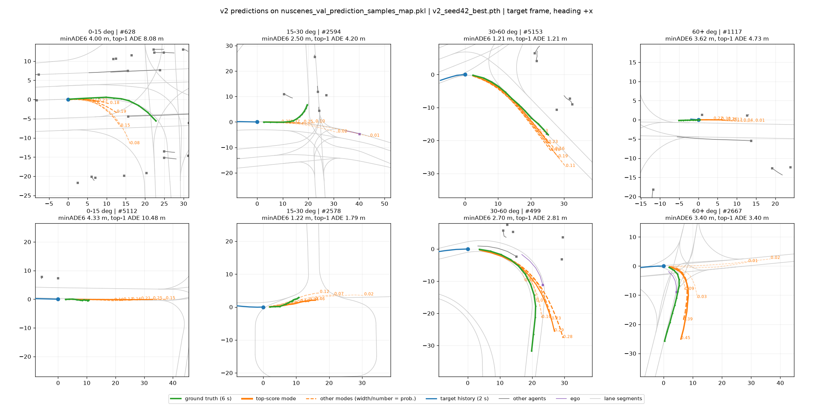
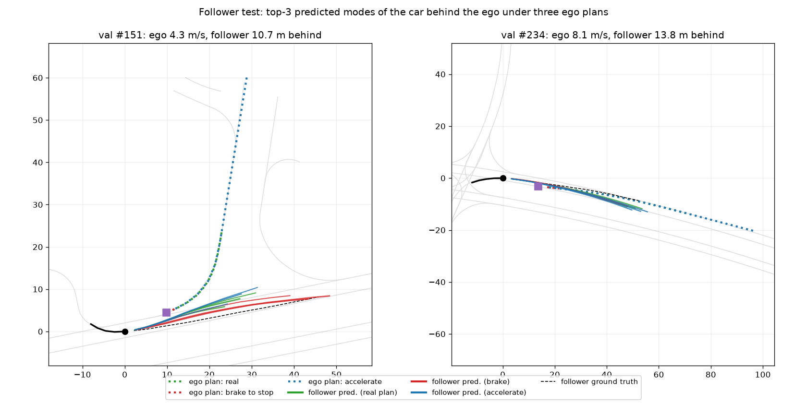
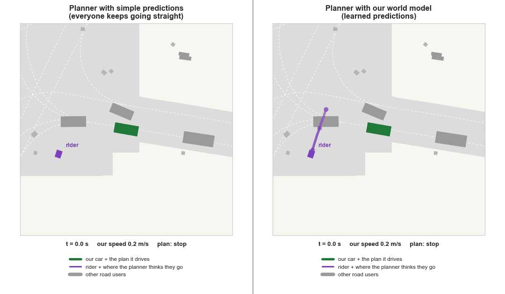
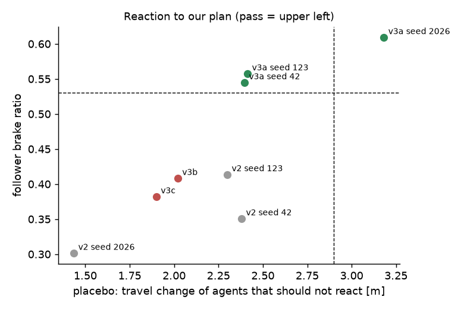
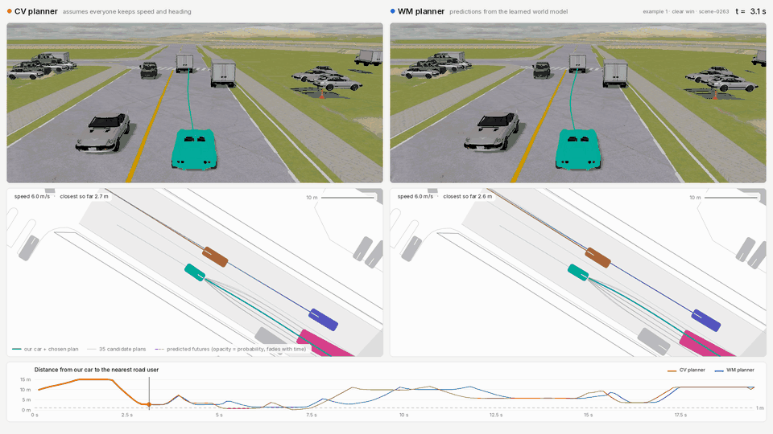
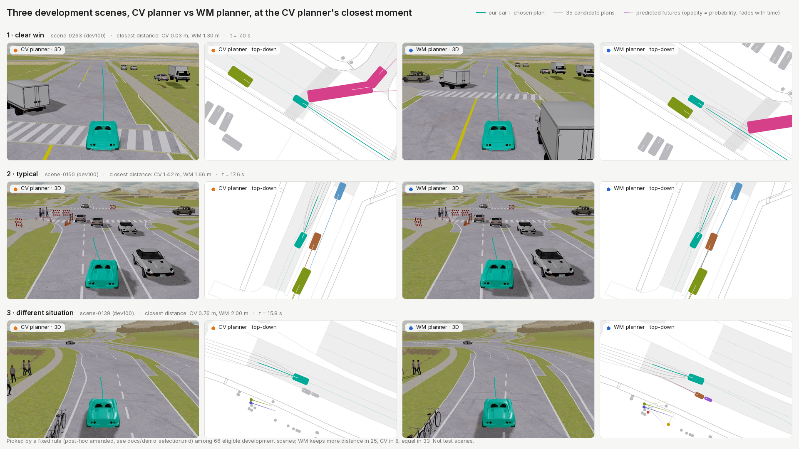

# obj-wm

Object-level, plan-conditioned world model (conditional behavior prediction) for sampling-based MPC planning on nuScenes.

A scene transformer predicts where the road users around our car will go in the next 6 s, **given the plan our car is
considering**. A sampling-based planner in [MetaDrive](https://github.com/metadriverse/metadrive) scores 35 candidate
plans against these predictions and re-plans every 0.5 s. On 146 held-out nuScenes test scenes, the world-model
planner spends less time close to other road users than the same planner with constant-velocity predictions, at the
same progress. Three attempts to make the model react more strongly to our plan (v3) were not confirmed.

> This `main` branch is the clean public version. The full working state (agent status files, per-step notes,
> v1-era scripts, the WOMD test list) is on branch [`workbench`](../../tree/workbench).

## Results: closed loop on 146 test scenes

The same planner is run with constant-velocity predictions (CV) and with the world model (WM). Other road users either
replay the log or react to our car.

| Planner | Other road users | At-fault collisions | Rear-ended | Progress | Time within 1 m of others |
|---|---|---|---|---|---|
| CV | replay the log | 1 | 14 | 0.921 | 10.7% |
| WM | replay the log | 0 | 16 | 0.923 | 6.0% |
| CV | react | 1 | 2 | 0.917 | 8.3% |
| WM | react | **0** | 2 | 0.917 | **3.6%** |

The decision rule was pre-registered. **The world-model planner is safer:** it spends 4.7 percentage points less time
within 1 m of others (97.5% CI [−8.0, −2.0] pp, p = 1e-4), with the same progress. At-fault collisions are too rare
to tell apart (1 vs 0).

Open-loop prediction error (val, target minADE₆) is **1.239 ± 0.006 m** over 3 seeds. Training the same seed with the
same flags on two machines (different GPUs and torch versions) gave 1.243 vs 1.268 m: **noise between machines
(~0.025 m) is larger than the spread over seeds.**

Numbers: [`results/`](results/) (JSON + the pre-registered test report). Every run: [docs/EXPERIMENTS.md](docs/EXPERIMENTS.md).

## Method

<p align="center">
  
</p>

- **Inputs:** 2 s of history of up to 64 nearby agents (incl. our car), lane segments (20 m tokens) in a 50 m box, and the ego plan
  (our candidate future, 6 s) as extra tokens.
- **Model:** a scene transformer with relative-pose attention; an anchor-based decoder predicts 6 paths with
  probabilities for the target and the 15 nearest road users (16 slots). The plan is dropped in 20% of training
  samples, so the model also works without it.
- **Planner:** 35 candidate plans (7 target speeds 0–12 m/s × 5 lateral offsets) along the logged route, scored by collision risk
  against the predicted futures, progress, comfort and lane offset; weights tuned on 10 development scenes and frozen.
- **Simulator:** nuScenes scenes converted with [ScenarioNet](https://github.com/metadriverse/scenarionet); other road
  users replay the log, or follow it with an IDM reaction to our car (`--reactive idm`).

<details>
<summary>More figures</summary>

<p align="center"></p>

*Open-loop predictions on val. Green: what happened; orange: the 6 predicted futures (number = probability).*

<p align="center"></p>

*The car behind ours is predicted to slow down when we plan to brake (red), and to speed up when we accelerate (blue).*

<p align="center"></p>

*Development scene (mini scene-1094): with constant-velocity predictions the conflict with a rider is seen 0.2 s
ahead and the car hits it; with the world model it slows down and passes.*

</details>

## v3 ablations: a stronger reaction to our plan? (not confirmed)

The v2 model reacts to our plan in the right direction, but too weakly: if we brake to a stop, the car behind is still
predicted to drive into us. Three single changes were tested against criteria written down before training
(open loop, val only):
- **Brake ratio:** how much of the needed slow-down of the following car is predicted (1 = enough to stay behind us).
- **Placebo:** how much cars that should *not* react (ahead, oncoming, next lane) change when only our plan changes.
- **Val accuracy:** target minADE₆ with the plan on.

| Model | Change | Brake ratio (≥ 0.53) | Placebo (≤ 2.9 m) | Val minADE₆ (≤ 1.259 m) | Result |
|---|---|---|---|---|---|
| v2 (3 seeds) | – | 0.30 – 0.41 | 1.44 – 2.38 | 1.232 – 1.243 | reference |
| v3a (3 seeds) | plan never dropped in training | 0.545 / 0.558 / 0.609 | 2.40 / 2.42 / **3.18** | 1.205 / 1.235 / **1.267** | **not confirmed** (seed 2026 fails) |
| v3b | decoder cross-attention to the plan | 0.408 | 2.02 | 1.206 | fails the brake check |
| v3c | other cars stand in as "ego" in training | 0.382 | 1.90 | 1.208 | fails the brake check |

Always giving the model our plan (v3a) makes the reaction consistently stronger, but it also leaks into cars that
should not react, and accuracy does not improve on average. Even the strongest v3a seed leaves 18 of 20 following
cars driving into a stopped ego. v2 stays the official model; no v3 closed-loop test was run.
v3a is this code with `--plan-drop 0`; v3b / v3c are on tags `v3b-xattn` / `v3c-stand-in`.

<p align="center"></p>

## Dataset finding: more data would not help

Waymo Open Motion (WOMD) and Argoverse 2 were checked for how often the ego brakes hard with a car close behind, the
situation that teaches this reaction. Both have fewer such events per ego-moving hour than nuScenes (WOMD 11.1, AV2
6.5 vs nuScenes 15.4; the pre-set gate was 2× nuScenes), so switching datasets was stopped
([docs/womd_feasibility.md](docs/womd_feasibility.md)).

## Examples (illustration)

Development scenes, not test scenes: these show what the planners do, the evidence is the table above.

<p align="center">
  
</p>

*Example 1 (dev100 scene-0263): a truck with a trailer turns across our lane. The CV planner (left) passes it at
0.03 m; the WM planner (right) slows and keeps 1.30 m. ~8 s around the closest moment, with a 0.5× slow-motion part
and a 1 s freeze-frame. [Full-resolution MP4](https://github.com/danilorar/obj-wm/releases/tag/v2-demo).*

<p align="center">
  
</p>

*Three development scenes at the CV planner's closest moment (3D view and top-down, CV vs WM). Picked by a fixed rule
among 66 eligible development scenes (no at-fault collision; WM never stops while the logged driver moves): largest
gain where CV gets within 1 m, median gain, largest gain of another situation type. Of the 66 eligible scenes, the WM
planner keeps more distance in 25, CV in 8, and they are equal in 33. Rules 1 and 3 were amended **post hoc**
(after seeing the first picks); rule, amendments and rendering notes: [docs/demo_selection.md](docs/demo_selection.md).*

## Limitations

- **Few at-fault events.** There is only 1 at-fault collision in 146 scenes, so the safety result rests on the
  close-call measure. That measure was made a primary endpoint after an earlier test run had been seen; this is
  disclosed in docs/EXPERIMENTS.md.
- **Limited coverage.** The model predicts 16 road users; the remaining ~15% nearby fall back to constant velocity.
- **Simple reactive road users.** Only cars and trucks react, there is no merge anticipation, and pedestrians and
  cyclists replay the log.
- **Weak reaction to our plan.** The predicted reaction to our plan is weaker than real drivers' (see v3).
- **Small open-loop differences are noisy** (cross-machine note above).
- **The WM planner is safe but can chatter (stop-and-go).** Every 0.5 s it picks the best of 35 plans with no cost for
  switching, on a coarse speed grid (0, 2, 4, … 12 m/s: nothing between standing and 2 m/s), while the multimodal
  predictions shift a little at each step. In one development scene it stopped for ~4 s mid-junction while the logged
  driver kept moving. Measured on the 100 dev100 development scenes from existing runs (no planner change; 2 Hz
  positions; [results/hesitation_dev100.json](results/hesitation_dev100.json)):

  | Other road users | Planner | Accel. sign flips / min (\|a\| > 1 m/s²) | Stop-go events / min | Mean \|jerk\| [m/s³] |
  |---|---|---|---|---|
  | replay | CV | 9.7 | 0.56 | 2.40 |
  | replay | WM | 13.4 | 0.90 | 2.75 |
  | react | CV | 8.6 | 0.37 | 2.23 |
  | react | WM | 12.0 | 0.74 | 2.58 |
  | – | logged driver | 8.0 | 0.31 | 1.25 |

  The test results above are for this planner as it is.

## Future work

- A physically plausible reaction to our plan, checked with the same follower / placebo test.
- Reactive road users, stage 2: swept ego footprint, merge anticipation, reacting pedestrians and cyclists.
- More predicted road users than 16 (32 / 63 slots were tested, see EXPERIMENTS.md).
- Several seeds per variant on one machine before any val threshold is applied.
- Smoother planning: a switching cost or hysteresis between consecutive plan choices, finer or continuous speed
  sampling (MPPI-style), and speed smoothing.

## Reproduce

**Easy path (no dataset):** re-make the tables and summary figures from the result files.

```bash
pip install matplotlib && python results/make_figures.py    # writes results/tables.md and results/figures/*.png
```

**Quickstart on nuScenes mini (~5 min after the download, any GPU or CPU).** Download from
[nuscenes.org/download](https://www.nuscenes.org/nuscenes#download) (free account, non-commercial terms): the *mini*
split (v1.0-mini) and the *map expansion v1.3*. Put the mini tables in `data/nuscenes_mini/v1.0-mini/` and the map
expansion (with its `prediction/` and `expansion/` folders) in `data/maps/`, then `ln -s ../maps data/nuscenes_mini/maps`.

```bash
python3.12 -m venv .venv && .venv/bin/pip install -r requirements.txt scikit-learn scipy
.venv/bin/python scripts/build_processed_dataset.py --mini --lane-tokens --workers 4   # mini_train / mini_val
.venv/bin/python scripts/make_anchors.py                                                # -> assets/anchors.npy
FLAGS="--model v2 --predict-agents 16 --ego-plan --target-split --plan-queries --plan-drop 0.2"
.venv/bin/python scripts/train_model.py $FLAGS --epochs 30 --seed 42 --checkpoint-dir checkpoints/mini
.venv/bin/python scripts/train_model.py $FLAGS --evaluate-only --checkpoint checkpoints/mini/v2_seed42_best.pth
# one closed-loop scene (simulator env, see below): CV and WM planners on mini scene-1094
.venv_sim/bin/python scripts/sim_check.py convert --scenes 10
.venv_sim/bin/python scripts/sim_check.py plan --predictor cv wm --scenes 8 \
    --checkpoint checkpoints/mini/v2_seed42_best.pth --out outputs/sim/quickstart.json
```

A model trained on mini alone is weak (val minADE₆ ≈ 3.5 m vs 1.24 m on the full data); the quickstart shows the
pipeline, not the results.

<details>
<summary>Full reproduction (nuScenes v1.0-trainval)</summary>

Put the v1.0-trainval metadata tables and the map expansion v1.3 in `data/`.

```bash
# simulator environment
uv venv --python 3.10 .venv_sim
git clone --depth 1 https://github.com/metadriverse/metadrive.git sim/metadrive
git clone --depth 1 https://github.com/metadriverse/scenarionet.git sim/scenarionet
VIRTUAL_ENV=.venv_sim uv pip install -e sim/metadrive -e sim/scenarionet "nuscenes-devkit>=1.1.10" ijson
VIRTUAL_ENV=.venv_sim uv pip install torch --index-url https://download.pytorch.org/whl/cu132
.venv_sim/bin/python -m metadrive.pull_asset

# dataset (~20 min), anchors, training of the official v2 model, validation
.venv/bin/python scripts/build_processed_dataset.py --lane-tokens --workers 6
.venv/bin/python scripts/make_anchors.py
bash scripts/train_official_v2.sh 42        # exact flags of run v2_d_rerun, incl. --plan-drop 0.2
.venv/bin/python scripts/analyze_v2.py --model v2 --checkpoint checkpoints/v2_d_seed42/v2_seed42_best.pth \
    --follower-test outputs/follower --follower-group follower            # also: lead / oncoming / side (placebo)

# closed loop: development scenes, then the final test (replay and reactive)
.venv_sim/bin/python scripts/sim_check.py convert --scenes 10
.venv_sim/bin/python scripts/sim_check.py convert --set test150 --scenes 146
CK=checkpoints/v2_d_seed42/v2_seed42_best.pth
.venv_sim/bin/python scripts/sim_check.py evaluate --data sim/scenarios/nuscenes_mini --checkpoint $CK --out outputs/sim/mini_check
.venv_sim/bin/python scripts/sim_check.py evaluate --data sim/scenarios/nuscenes_test150 --checkpoint $CK --out outputs/sim/test150_v4
.venv_sim/bin/python scripts/sim_check.py evaluate --data sim/scenarios/nuscenes_test150 --checkpoint $CK --reactive idm \
    --out outputs/sim/test150_reactive
```

`--plan-drop` defaults to 0.5 (older runs rely on it); the official model passes 0.2 explicitly. Training is not
bit-reproducible across machines (see above). Data splits: train = training, val = all selection and tuning,
test = final numbers only.

</details>

## Data & licences

- **nuScenes** is licensed under [CC BY-NC-SA 4.0](https://www.nuscenes.org/terms-of-use) (non-commercial).
  This repository contains **no** nuScenes data: no tables, processed samples, camera images, model weights or
  anchors (which are fitted on nuScenes; `scripts/make_anchors.py` regenerates them). The figures and the result files in
  `results/` are derived from nuScenes for non-commercial research. Trained checkpoints are not distributed.
  If you use nuScenes, cite: H. Caesar et al., *nuScenes: A multimodal dataset for autonomous driving*, CVPR 2020.
- **Simulator:** [MetaDrive](https://github.com/metadriverse/metadrive) (Q. Li et al., *MetaDrive: Composing Diverse
  Driving Scenarios for Generalizable Reinforcement Learning*, IEEE TPAMI 2022) and
  [ScenarioNet](https://github.com/metadriverse/scenarionet) (Q. Li et al., *ScenarioNet: Open-Source Platform for
  Large-Scale Traffic Scenario Simulation and Modeling*, NeurIPS 2023 Datasets and Benchmarks). They are installed
  from their own repositories, not included here.
- **WOMD / Argoverse 2:** only statistics are reported; no data from either dataset is included.
- **Code:** MIT ([LICENSE](LICENSE)), for this repository's code only; datasets keep their own terms.

## Credits

v2 builds on v1, a GNN trajectory predictor made as a course project for SSY340 Deep Machine Learning at Chalmers
(Group 33) with Ashok Ramasamy, Yanran Xie and Kaushik Rathnakar Shetty:
[gnn-trajectory](https://github.com/danilorar/gnn-trajectory) (tag `v1-gnn` here).
