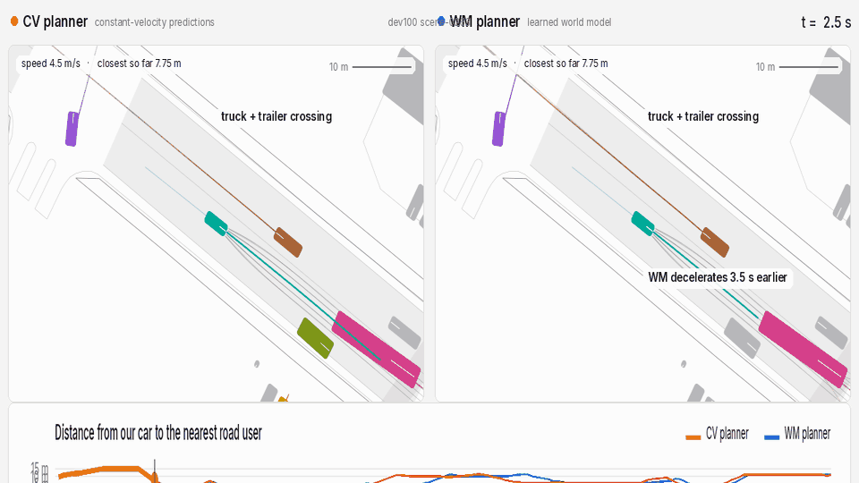

# obj-wm

Object-level, plan-conditioned world model for sampling-based MPC planning on nuScenes.

> `main` is the clean public version. Full working state (agent notes, v1-era scripts, WOMD files) is on branch [`workbench`](../../tree/workbench).

## Showcase

<p align="center">
  
</p>

*dev100 scene-0263 (development). Truck with trailer crosses our lane. CV comes within 0.03 m; WM keeps 1.30 m — it decelerates 3.5 s earlier.*

<p align="center">
  
</p>

*mini scene-1094 (development). Rider enters from the left. CV: at-fault collision. WM keeps 0.83 m — it decelerates 3.5 s earlier.*

Both are development scenes (never test), picked by a fixed rule: largest WM–CV distance gap among scenes where CV had a close call (< 1 m) and WM didn't, plus one of a different road-user type (personal mobility device vs vehicle). Typical scenes are much closer — the evidence is the table below.

## How it works

- **World model:** scene transformer that predicts road-user futures conditioned on our candidate plan; trained with 20% plan dropout so it also works without a plan.
- **Planner:** sampling-based MPC — 35 candidate plans (7 target speeds × 5 lateral offsets) scored against predicted futures for risk, progress, comfort and lane offset; re-planned every 0.5 s.
- **Simulator:** nuScenes scenes converted with [ScenarioNet](https://github.com/metadriverse/scenarionet) into [MetaDrive](https://github.com/metadriverse/metadrive); other road users replay the log or react to our car with an IDM rule.
- **Evaluation:** pre-registered closed-loop test on 146 held-out nuScenes scenes, with and without reactive road users.

## Results: closed loop on 146 test scenes

| Planner | At-fault collisions¹ | Close-call share² | Progress³ |
|---|---|---|---|
| CV | 1 | 8.3% | 0.917 |
| **WM** | **0** | **3.6%** | **0.917** |

Other road users react to the ego car (reactive IDM).

¹ Our car strikes another; 1 vs 0 is too rare for a statistical test.  
² Share of steps with any road user within 1 m. WM − CV = −4.7 pp (97.5% CI [−8.0, −2.0], p = 1×10⁻⁴) — **pre-registered primary endpoint**.  
³ Fraction of logged route completed; difference 0.000 (95% CI [−0.005, +0.006]).

Details: [docs/EXPERIMENTS.md](docs/EXPERIMENTS.md) · raw numbers: [`results/`](results/)

## Quickstart

**Download first** (free [nuScenes account](https://nuscenes.org/nuscenes#download), non-commercial):
the *mini* split (`v1.0-mini.tgz`, ~500 MB) and *map expansion v1.3* (~200 MB). Extract:

```bash
mkdir -p data/nuscenes_mini && tar xf v1.0-mini.tgz -C data/nuscenes_mini/
mkdir -p data/maps && unzip nuScenes-map-expansion-v1.3.zip -d data/maps/
ln -s ../maps data/nuscenes_mini/maps
```

Then run:

```bash
make setup       # create Python environments (~5 min)
make data        # process nuScenes mini into training data
make train-mini  # train the world model (30 epochs, ~30 min on a GPU)
make demo        # run one scene closed-loop, write outputs/demo/scene1094_wm_vs_cv.gif
```

The mini-only model is weak (val minADE₆ ≈ 3.5 m vs 1.24 m on full data); the quickstart shows the pipeline, not the results. To reproduce the results above, see [docs/EXPERIMENTS.md § Full reproduction](docs/EXPERIMENTS.md#full-reproduction-nuscenes-v10-trainval).

## Limitations

- **Few at-fault events.** Only 1 at-fault collision across 146 test scenes, so the safety result rests on the close-call share. That measure was promoted to a co-primary endpoint after an earlier non-registered run; this is disclosed in [docs/EXPERIMENTS.md](docs/EXPERIMENTS.md).
- **Limited coverage.** The model predicts 16 road users; the remaining ~15% of nearby agents fall back to constant velocity.
- **Weak reaction to our plan.** The predicted following car barely slows when we brake hard (brake ratio 0.3–0.4 of what a real driver would do). Three stronger variants (v3a/b/c) were tested; none was confirmed — details in [docs/EXPERIMENTS.md](docs/EXPERIMENTS.md).
- **WM planner chattering.** On dev100 the WM planner makes 1.4× more accel-sign flips per minute than CV. Four planner-side fixes were tested; each traded smoothness for safety. Root cause: risk flicker in WM predictions between replanning steps.

## Future work

- A physically plausible reaction to our plan, checked with the same follower / placebo test.
- Reactive road users, stage 2: swept ego footprint, merge anticipation, reacting pedestrians and cyclists.
- More predicted road users than 16 (32 / 63 slots were tested; see [docs/EXPERIMENTS.md](docs/EXPERIMENTS.md)).
- Several seeds per variant on one machine before any val threshold is applied.
- **Smoother planning** via temporally consistent WM predictions; planner-side fixes (switching cost, veto hysteresis, risk smoothing, risk-aware hold) were tested and each traded chattering for a safety cost.

## Data & licences

**nuScenes** is [CC BY-NC-SA 4.0](https://www.nuscenes.org/terms-of-use) (non-commercial). This repository contains no nuScenes data, processed samples, or trained weights. **Simulator:** MetaDrive and ScenarioNet are installed from their own repositories, not included here. **Code:** MIT ([LICENSE](LICENSE)).

## Credits

v2 builds on v1, a GNN trajectory predictor made as a course project for SSY340 Deep Machine Learning at Chalmers (Group 33) with Ashok Ramasamy, Yanran Xie and Kaushik Rathnakar Shetty: [gnn-trajectory](https://github.com/danilorar/gnn-trajectory) (tag `v1-gnn` here).
